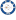

# evanderfan

M.S. student at UESTC (2028) · inference systems, AI infra, and high-performance kernels

## Internships

 &nbsp;**ByteDance** · AI Chip Team · Intern · NPU model modeling and simulation · 2026 H1 
 &nbsp;**A Major Foundation-Model Company** · Intern · Kernel development and framework integration · 2026 H2 – Present

## Education

 &nbsp;**University of Electronic Science and Technology of China** · M.S., expected 2028 
 &nbsp;**Sichuan University** · B.S.

## Say hi

✉️ [evanderfff123@gmail.com](mailto:evanderfff123@gmail.com)
